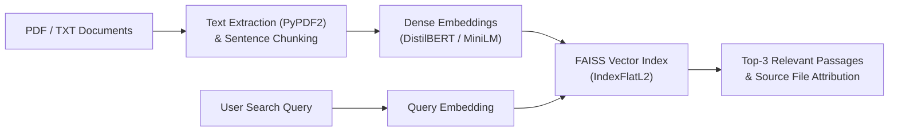

# Semantic Search Analysis over Documents


A **Multi-Document Semantic Search Engine** that ingests multiple PDF and TXT documents, splits them into semantic chunks, generates dense transformer embeddings, indexes them in **FAISS** (`IndexFlatL2`), and retrieves the top-k most relevant passages and source filenames for natural-language queries.

This repository includes two deployment modes:
1. **Full-Stack Web Application** (`backend/` + `frontend/`): **Flask** REST API powered by **DistilBERT** (`distilbert-base-uncased`) + **FAISS**, paired with a **React 18** frontend.
2. **Streamlit Application** (`streamlit_app/`): Single-file **Streamlit** interface powered by **Sentence-Transformers** (`paraphrase-multilingual-MiniLM-L12-v2`) + **FAISS**.

---

## Architecture



---

## Project Structure

```text
Semantic-Search-Analysis/
├── backend/                          # Flask REST API (DistilBERT + FAISS)
│   ├── app.py                        # /upload and /search endpoints (port 5001)
│   └── requirements.txt              # Backend Python dependencies
├── frontend/                         # React 18 frontend client
│   ├── public/
│   ├── src/
│   │   ├── App.js                    # Query interface & search result cards
│   │   └── components/FileUpload.js  # Multi-file PDF/TXT upload component
│   └── package.json
├── streamlit_app/                    # Standalone Streamlit implementation
│   ├── app.py                        # Streamlit UI (SentenceTransformer + FAISS)
│   └── requirements.txt              # Streamlit app dependencies
└── Test Files/                       # Sample PDF & TXT documents for testing
    ├── AI Intro.pdf
    ├── AI Intro.txt
    ├── Cricket.pdf
    ├── Football.pdf
    └── Formula 1.pdf
```

---

## Getting Started

### Option A: Full-Stack Mode (React + Flask + DistilBERT)

#### 1. Start the Flask Backend (Port `5001`)

```bash
cd backend
python -m venv venv
source venv/bin/activate  # On Windows: venv\Scripts\activate
pip install -r requirements.txt
python app.py
```

#### 2. Start the React Frontend (Port `3000`)

```bash
cd frontend
npm install
npm start
```

Open `http://localhost:3000` in your browser, upload one or more PDF/TXT files from `Test Files/`, and run semantic queries across them.

---

### Option B: Standalone Streamlit Mode (Sentence-Transformers + FAISS)

```bash
cd streamlit_app
python -m venv venv
source venv/bin/activate  # On Windows: venv\Scripts\activate
pip install -r requirements.txt
streamlit run app.py
```

Open `http://localhost:8501` in your browser to upload documents and search interactively.

---

## API Reference (Flask Backend)

| Endpoint | Method | Payload | Description |
| :--- | :--- | :--- | :--- |
| `/upload` | `POST` | `multipart/form-data` (`files`) | Extracts text from uploaded `.pdf` and `.txt` files, chunks sentences, generates batched DistilBERT embeddings, and builds the FAISS L2 index. |
| `/search` | `POST` | `{"query": "your search query"}` | Encodes the query with DistilBERT and returns the top 3 matching document chunks and their source filenames. |
